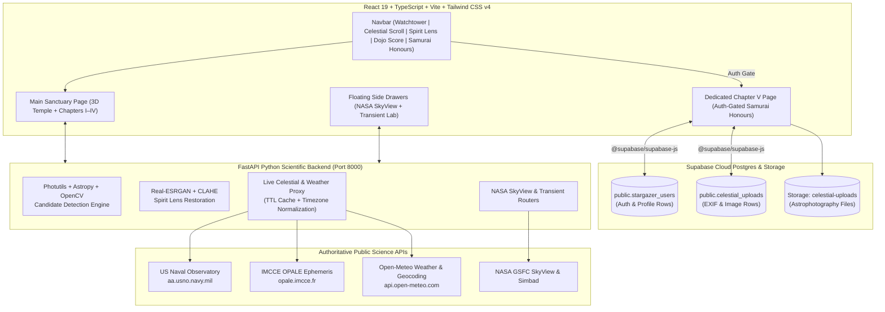

# 🌙 TSUKUYOMI WATCH (月読命) — *The Samurai's Celestial Guide*
**PECathon 2026 Official Submission • Team PF-XBZYZH**

- 🚀 **Live Production App (Vercel):** **[https://tsukuyomi-watch-mu.vercel.app](https://tsukuyomi-watch-mu.vercel.app)**
- 🗄️ **Cloud Database & Storage:** **Supabase Postgres (`public.stargazer_users`, `public.celestial_uploads`) & Storage (`celestial-uploads`)**
- 📦 **Official Repository:** **[https://github.com/PECathon-2026/Team-PF-XBZYZH](https://github.com/PECathon-2026/Team-PF-XBZYZH)**

> A comprehensive astronomical observation, AI optical restoration, photometric source detection, and gamified stargazing platform inspired by traditional Japanese *sumi-e* & samurai sanctuary aesthetics.

---

## 🏮 Table of Contents
1. [Project Overview](#-project-overview)
2. [Core Chapters & Modules](#-core-chapters--modules)
   - [Section 0: 3D Kage Temple Sanctuary](#section-0-3d-kage-temple-sanctuary)
   - [Chapter I: The Watchtower (Dark-Sky Map & Telemetry)](#chapter-i-the-watchtower--望楼観測)
   - [Chapter II: The Celestial Scroll (Live Ephemeris & Launches)](#chapter-ii-the-celestial-scroll--星々の記録)
   - [Chapter III: Spirit Lens (Real-ESRGAN & Photutils Astro-Detection)](#chapter-iii-spirit-lens--鏡花水月)
   - [Chapter IV: Dojo Score (USNO, IMCCE & Open-Meteo Live Telemetry)](#chapter-iv-dojo-score--夜の誉れ)
   - [Chapter V: Samurai Honours (Auth-Gated Celestial Game & Supabase Cloud)](#chapter-v-samurai-honours--侍の誉れ-auth-gated-web-page)
   - [Sidecar Observatories: NASA SkyView Lens & Transient Spectral Lab](#sidecar-observatories-nasa-skyview-lens--transient-spectral-lab)
3. [System Architecture](#-system-architecture)
4. [Supabase Database Schema (`stargazer_users` & `celestial_uploads`)](#-supabase-database-schema)
5. [Public Astronomical & Weather APIs](#-public-astronomical--weather-apis)
6. [Quickstart & Installation](#-quickstart--installation)
7. [API Reference (FastAPI Backend)](#-api-reference-fastapi-backend)
8. [Automated Verification & Test Suite](#-automated-verification--test-suite)

---

## ⛩️ Project Overview

**Tsukuyomi Watch** bridges scientific astrophotography, real-time astronomical ephemerides, and community citizen science inside a cohesive Japanese celestial interface:

- **Zero Fabricated Telemetry:** Live weather forecasts (**Open-Meteo**), lunar phase tables (**US Naval Observatory**), and lunar eclipse predictions (**IMCCE OPALE**) are clearly distinguished from live telescope feeds, displaying data provenance and last-updated timestamps in the user's local timezone.
- **Anti-Hallucination Optical Ethics:** In **Spirit Lens**, deterministic CLAHE and **Real-ESRGAN** restorations are cross-matched against raw pixel data using **Astropy** and **Photutils** (`Background2D`, `DAOStarFinder`, `detect_sources`, `deblend_sources`) so users can distinguish genuine point/extended celestial sources from enhancement artifacts.
- **Authenticated Citizen Science & Gamification:** Clicking **Samurai Honours** in the navigation bar authenticates Stargazers against **Supabase Postgres (`public.stargazer_users`)** and unlocks the dedicated **Chapter V** web page featuring the 88 IAU Constellations Catalog, EXIF camera hardware & GPS verification, Supabase Storage image uploads (`public.celestial_uploads`), and the Shared Sky community wall.

---

## 🧭 Core Chapters & Modules

### Section 0: 3D Kage Temple Sanctuary
- Interactive WebGL / Three.js Japanese night temple landing experience (`src/components/Scene.tsx`) with atmospheric particle shaders and smooth scroll transition into the four main chapters.

### Chapter I: The Watchtower • 望楼観測
- **Interactive Dark-Sky Cartography:** Built with **Leaflet** and Carto Dark Matter basemaps (`src/watchtower/WatchtowerModule.tsx`).
- **Global Search & Nearby Sanctuaries:** Geocodes any city or observatory worldwide via Open-Meteo Geocoding API and discovers dark-sky observing spots within a configurable radius.
- **Hourly Forecast Strip & Best Observation Window:** Computes the optimal night-sky observation hours based on cloud cover, humidity, and optical visibility.

### Chapter II: The Celestial Scroll • 星々の記録
- **Unified Cosmic Chronicle (`src/pages/CelestialScrollPage.tsx`):** Tracks upcoming orbital rocket launches (**The Space Devs Launch Library 2**), **IMCCE OPALE** lunar eclipses (penumbral, partial, total), meteor showers, and planetary alignments.
- **Interactive Filtering & ICS Calendar Export:** Filter by event type, visibility region, or naked-eye vs. optical aid requirements, and pledge watch to earn Samurai Honor XP.

### Chapter III: Spirit Lens • 鏡花水月
- **Real-ESRGAN Restoration & Deterministic CLAHE (`src/pages/SpiritLensPage.tsx`, `backend/routers/restoration.py`):** Enhances noisy or faint deep-sky exposures with side-by-side interactive comparison sliders and downloadable outputs.
- **Astronomical Star & Galaxy Candidate Detection System (`src/components/AstroDetectionWorkspace.tsx`, `backend/services/astro_detector.py`):**
  - **2D Spatially Varying Background Estimation:** Uses `photutils.background.Background2D` with `MedianBackground` and Astropy `SigmaClip(sigma=3.0)` on an adaptive mesh grid.
  - **Point-Source (Star) & Extended-Source (Galaxy) Detection:** Combines 2D Gaussian matched-filter segmentation (`detect_sources`, `deblend_sources`, `SourceCatalog`) with `DAOStarFinder` and circular aperture photometry (`CircularAperture`, `aperture_photometry`).
  - **Measured Photometric & Morphological Properties:** Centroid `(x, y)`, bounding box, peak intensity, background-subtracted flux (`ADU`), radial FWHM (`px`), area (`px²`), semi-major/semi-minor axes (`a`, `b`), ellipticity (`1 - b/a`), orientation (`deg`), SNR, and original-vs-restored cross-match provenance (`both`, `original_only`, `restored_only`).
  - **Interactive Canvas Overlay & Catalog Export:** Filter by classification or SNR, click any marker to inspect its zoomed cutout and metrics, and export detections as **CSV** or **JSON**.

### Chapter IV: Dojo Score • 夜の誉れ
- **Transparent Night Honor Score (`src/components/HonorScoreGauge.tsx`):**
  $$\text{Score} = (0.53 \times \text{ClearSky}) + (0.29 \times \text{VisibilityScore}) + (0.18 \times \text{HumidityScore})$$
- **Live USNO Moon Phases (`src/components/MoonPhaseCard.tsx`):** Computes instantaneous lunar illumination, waxing/waning status, and exact upcoming primary moon phases (`New Moon`, `First Quarter`, `Full Moon`, `Last Quarter`) from the **US Naval Observatory API**.
- **Live IMCCE Lunar Eclipses (`src/components/EventCard.tsx`):** Displays calculated lunar eclipse dates, magnitude, and visibility from the **Institut de Mécanique Céleste et de Calcul des Éphémérides (IMCCE)**.

### Chapter V: Samurai Honours • 侍の誉れ *(Auth-Gated Web Page)*
- Accessible via the **Samurai Honours** button in the top navigation bar (`src/components/Navbar.tsx`).
- **Step 1 — Stargazer Authentication (`src/components/SignupModal.tsx`):** Registers or signs in users with their Clan Crest Avatar (`🌸`, `🌙`, `🦉`, `🏮`, `🔭`, `⭐`, `🪐`, `☄️`), Stargazer Name, Email, Passphrase, and Home Sanctuary, syncing directly with **Supabase (`public.stargazer_users`)**.
- **Step 2 — Dedicated Chapter V Web Page (`src/pages/CelestialGamePage.tsx` & `src/components/SamuraiGamificationHub.tsx`):**
  - **📜 My Celestial Catalog:** All 88 IAU Constellations, 7 Planets, 8 Moon Phases, 12 Deep-Sky Objects, and 6 Rare Cosmic Events with procedural SVG celestial artwork.
  - **🔮 AI Upload & Verify:** Extracts real optical camera EXIF metadata (`exifr`)—verifying capture timestamp, night-window hours (`17:00–06:00`), GPS coordinates, and camera Make/Model (filtering out editing/AI software signatures)—uploads the image to **Supabase Storage (`celestial-uploads`)**, and inserts the structured record into **`public.celestial_uploads`**.
  - **🌕 Rare Event & Shared Sky:** Live community astrophotography wall with Lantern (`🏮`) and Bow (`🙇`) reactions.
  - **🏮 Collectors & Leaderboard:** Global Stargazer rankings by Honor XP and catalog completion percentage, plus interactive Samurai Trials & Blood Moon Lore Quiz.

### Sidecar Observatories: NASA SkyView Lens & Transient Spectral Lab
- **NASA SkyView Virtual Observatory (`src/components/SkyLanternLens/`, `backend/routers/skyview.py`):** Floating side drawer querying multi-wavelength astronomical surveys (**Optical DSS2 Red**, **2MASS Near-Infrared**, **WISE Mid-IR**, **GALEX UV**, **ROSAT X-Ray**) with real coordinate lookup via **Simbad / Sesame**.
- **Transient Spectral & Time-Domain Divination Lab (`src/components/TransientAnalysis/`, `backend/routers/transient.py`):** Interactive light-curve and spectral line analyzer for supernovae (`SN Ia`, `SN II`), kilonovae, tidal disruption events (`TDE`), cataclysmic variables (`CV`), and active galactic nuclei (`AGN`), complete with Web Audio API astronomical sonification.

---

## 🏗️ System Architecture



---

## 🗄️ Supabase Database Schema

The full SQL migration is located in [`supabase/schema.sql`](./supabase/schema.sql) and is connected to our live Supabase project (`https://lcwsuzobacqzbutqwmvh.supabase.co`).

### 1. Table: `public.stargazer_users`
Stores authenticated Stargazer accounts, Clan Crest avatars, Honor XP, ranks, and event stamps.

| Column | Type | Constraints | Description |
| :--- | :--- | :--- | :--- |
| `id` | `uuid` | `PRIMARY KEY DEFAULT gen_random_uuid()` | Unique Stargazer record UUID |
| `auth_user_id` | `uuid` | `UNIQUE REFERENCES auth.users(id)` | Optional linked Supabase Auth UUID |
| `email` | `text` | `UNIQUE NOT NULL` | Stargazer email address |
| `name` | `text` | `NOT NULL` | Stargazer display name |
| `password_hash` | `text` | `NULLABLE` | Salted SHA-256 passphrase hash |
| `location` | `text` | `NOT NULL DEFAULT 'Kyoto, JP'` | Home dark-sky sanctuary or city |
| `avatar` | `text` | `NOT NULL DEFAULT '🌸'` | Selected Samurai Clan Crest |
| `honor_xp` | `integer` | `NOT NULL DEFAULT 150` | Accumulated Honor XP |
| `rank_title` | `text` | `NOT NULL DEFAULT 'Star Seeker'` | Computed Stargazer rank title |
| `stamps` | `text[]` | `NOT NULL` | Array of earned cosmic event seals |
| `prefill_demo` | `boolean` | `NOT NULL DEFAULT true` | Starter catalog prefill flag |
| `registered_at` | `timestamptz` | `NOT NULL DEFAULT now()` | Account registration timestamp |
| `last_login_at` | `timestamptz` | `NOT NULL DEFAULT now()` | Most recent login timestamp |

### 2. Table: `public.celestial_uploads`
Stores every uploaded astrophotography observation, hardware EXIF telemetry, GPS coordinates, and Spirit Lens verification results.

| Column | Type | Constraints | Description |
| :--- | :--- | :--- | :--- |
| `id` | `uuid` | `PRIMARY KEY DEFAULT gen_random_uuid()` | Unique upload record UUID |
| `user_id` | `uuid` | `REFERENCES public.stargazer_users(id)` | Foreign key to Stargazer profile |
| `user_email` | `text` | `NOT NULL` | Uploader email address |
| `author_name` | `text` | `NOT NULL` | Uploader display name |
| `author_avatar` | `text` | `NOT NULL` | Uploader Clan Crest emoji |
| `item_id` | `text` | `NOT NULL` | Catalog item ID (e.g. `event-blood-moon-eclipse`) |
| `item_name` | `text` | `NOT NULL` | Catalog object name |
| `category` | `text` | `NOT NULL` | Category (`con`, `planet`, `moon`, `deep`, `event`) |
| `observation_location` | `text` | `NOT NULL` | Sanctuary / observing location |
| `camera_make` / `camera_model` | `text` | `NULLABLE` | Raw EXIF camera hardware Make & Model |
| `camera_gear` | `text` | `NULLABLE` | Combined optical gear summary |
| `captured_at` | `timestamptz` | `NULLABLE` | Original EXIF capture timestamp |
| `gps_latitude` / `gps_longitude` | `double precision` | `NULLABLE` | Authenticated EXIF GPS coordinates |
| `image_url` / `storage_path` | `text` | `NULLABLE` | Public URL & path in `celestial-uploads` bucket |
| `spirit_lens_enhanced` | `boolean` | `NOT NULL DEFAULT false` | Whether Spirit Lens CLAHE was applied |
| `shared_to_sky` | `boolean` | `NOT NULL DEFAULT true` | Whether published to Shared Sky wall |
| `verification_passed` | `boolean` | `NOT NULL DEFAULT true` | Whether all 5 EXIF authenticity checks passed |
| `match_score` | `integer` | `NOT NULL DEFAULT 95` | Photometric verification score (%) |
| `honor_awarded` | `integer` | `NOT NULL DEFAULT 50` | Honor XP awarded for this observation |
| `exif_checks` | `jsonb` | `NOT NULL DEFAULT '[]'` | Detailed 5-point EXIF verification breakdown |
| `created_at` | `timestamptz` | `NOT NULL DEFAULT now()` | Database insertion timestamp |

---

## 🌐 Public Astronomical & Weather APIs

No paid API keys are required for the core astronomical and meteorological integrations:

1. **US Naval Observatory (USNO) Moon Phases API**
   - Endpoint: `https://aa.usno.navy.mil/api/moon/phases/year?year={year}`
   - Provides authoritative primary moon phase dates and UTC timestamps (`New Moon`, `First Quarter`, `Full Moon`, `Last Quarter`).
2. **IMCCE OPALE Lunar Eclipses Ephemeris API**
   - Endpoint: `https://opale.imcce.fr/api/v1/phenomena/eclipses/301/{year}`
   - Provides calculated lunar eclipse types (`Total`, `Partial`, `Penumbral`), calendar dates, and visibility zones.
3. **Open-Meteo Weather Forecast & Geocoding APIs**
   - Endpoint: `https://api.open-meteo.com/v1/forecast?latitude={lat}&longitude={lon}&hourly=cloud_cover,relative_humidity_2m,visibility&forecast_days=1`
   - Provides dynamic hourly cloud cover (`%`), 2-meter relative humidity (`%`), and optical visibility (`m`) for any selected coordinate.

---

## 🚀 Quickstart & Installation

### Prerequisites
- **Node.js** v18+ (or v20/v22)
- **Python** 3.10+ (for the FastAPI scientific backend)

### 1. Frontend Setup
```bash
# Clone the repository
git clone https://github.com/PECathon-2026/Team-PF-XBZYZH.git
cd Team-PF-XBZYZH

# Install frontend dependencies
npm install

# Start the Vite development server (http://localhost:5173)
npm run dev
```

### 2. Backend Setup (FastAPI + Photutils + Astropy + Real-ESRGAN)
```bash
cd backend

# Create and activate virtual environment (Windows PowerShell)
python -m venv .venv
.\.venv\Scripts\Activate.ps1

# Install scientific & API dependencies
pip install -r requirements.txt

# Launch FastAPI server on port 8000 (http://localhost:8000/docs)
python -m uvicorn main:app --host 0.0.0.0 --port 8000
```

### 3. Environment Variables (`.env`)
Copy `.env.example` to `.env`:
```env
VITE_APP_MODE=live

# Supabase Cloud Database & Storage (Chapter V: Samurai Honours)
VITE_SUPABASE_URL=https://lcwsuzobacqzbutqwmvh.supabase.co
VITE_SUPABASE_ANON_KEY=sb_publishable_Vd1NePWLZcggX8aJ1v0Xpg_-b5DIoKi
VITE_SUPABASE_PUBLISHABLE_KEY=sb_publishable_Vd1NePWLZcggX8aJ1v0Xpg_-b5DIoKi

# Public Science & Weather Endpoints
OPEN_METEO_WEATHER_URL=https://api.open-meteo.com/v1/forecast
OPEN_METEO_GEOCODE_URL=https://geocoding-api.open-meteo.com/v1/search
NASA_SKYVIEW_URL=https://skyview.gsfc.nasa.gov/current/cgi/runquery.pl
```

---

## 🔌 API Reference (FastAPI Backend)

| Method | Endpoint | Description |
| :--- | :--- | :--- |
| `GET` | `/health` | Service health check |
| `GET` | `/api/celestial/moon-phases?year={year}` | Live **USNO** Moon phases + instantaneous illumination & phase age |
| `GET` | `/api/celestial/lunar-eclipses?year={year}` | Live **IMCCE OPALE** lunar eclipses for `year` and `year + 1` |
| `GET` | `/api/celestial/weather-forecast?lat={lat}&lon={lon}` | Live **Open-Meteo** hourly cloud cover, humidity, visibility & Night Honor Score |
| `GET` | `/api/celestial/events` | Unified cosmic events & rocket launches feed |
| `GET` | `/api/weather?lat={lat}&lon={lon}` | Watchtower hourly atmospheric breakdown & best observing window |
| `GET` | `/api/geocode?q={query}` | Global city & sanctuary geocoding |
| `GET` | `/api/nearby?lat={lat}&lon={lon}&radius_km={r}` | Dark-sky observing spots near coordinates |
| `POST` | `/api/images/detect-objects` | Run **Photutils/Astropy** star & galaxy candidate detection on uploaded image |
| `GET` | `/api/images/{image_id}/detections` | Retrieve full candidate detection catalog & sky background stats |
| `GET` | `/api/images/{image_id}/detections/{id}` | Inspect single candidate with zoomed base64 cutout |
| `GET` | `/api/images/{image_id}/detection-overlay` | Download annotated PNG overlay with markers & bounding ellipses |
| `GET` | `/api/images/{image_id}/detections/export` | Export detections in `csv` or `json` format |
| `POST` | `/api/restoration/enhance` | Run Spirit Lens Real-ESRGAN / CLAHE astrophotography restoration |
| `GET` | `/api/skyview/survey` | Fetch multi-wavelength **NASA SkyView** survey cutout |
| `POST` | `/api/transient/analyze` | Classify transient light-curve & spectrum (`SN Ia`, `SN II`, `Kilonova`, `TDE`, `AGN`) |

---

## 🧪 Automated Verification & Test Suite

Run the complete **41-test** backend test suite covering **Photutils/Astropy source detection**, **USNO/IMCCE/Open-Meteo live APIs**, and **Transient Spectral classification**:

```bash
cd backend
.\.venv\Scripts\python -m pytest tests/ -v
```

Build the production TypeScript & Vite bundle:
```bash
npm run build
```

---

## 📜 License & Attribution
- **Ephemeris & Astronomical Data:** US Naval Observatory (USNO), IMCCE OPALE, NASA GSFC SkyView, CDS Simbad, The Space Devs Launch Library 2.
- **Meteorological & Map Data:** Open-Meteo API, OpenStreetMap contributors, CartoDB Dark Matter.
- **Built for PECathon 2026 by Team PF-XBZYZH.**
